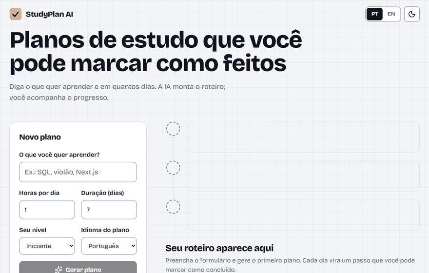
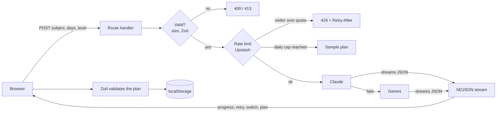

<div align="center">

# StudyPlan AI

**Study plans you can check off.** Say what you want to learn and in how many days; an AI writes the route and you track your progress.

[](https://github.com/raabesmps/studyplan-ai/actions/workflows/ci.yml)
[](https://github.com/raabesmps/studyplan-ai/actions/workflows/uptime.yml)
[](https://studyplan.aquifunciona.dev.br)




**[Try it live](https://studyplan.aquifunciona.dev.br)** · [Português](#português)

</div>

---

## What it does

- **Generates a 1 to 30 day plan** on any subject, for a level and a number of hours per day. Each day has a goal, topics, exercises and search suggestions.
- **Shows real progress while it writes**: the timeline fills in day by day as the model streams, and you can cancel at any time.
- **Tracks your progress**: tick exercises and whole days off; plans and progress are saved in your browser (`localStorage`), no account needed.
- **Exports** the plan as Markdown (copy or download), as a calendar file (`.ics`, one event per day at the time you choose) or as a PDF through the print dialog.
- **Speaks Portuguese and English**, with a light and a dark theme that follow your system until you pick one.
- **Keeps working when the AI does not**: Claude answers first; if it fails, Gemini takes over and the page tells you so.

## How it works



The server never trusts the model: the JSON it returns is parsed and validated with [Zod](https://zod.dev) (shape, number of days, sequential numbering), and one repair attempt is made if the format is wrong. The browser validates again before saving anything.

## Tech stack

| Area | Choice |
|------|--------|
| Framework | Next.js 16 (App Router, route handlers, Turbopack), React 19, TypeScript 6 |
| Styling | Tailwind CSS 3 with CSS-variable tokens for both themes |
| AI | Claude (`@anthropic-ai/sdk`, default `claude-haiku-5-5`) with Gemini (REST streaming) as the failover |
| Validation | Zod 4, used for requests, model output and stored data |
| Rate limiting | Upstash Redis over its REST API (no extra dependency) |
| Tests | Vitest + Testing Library (unit, API, components), Playwright + axe-core (end to end) |
| CI / hosting | GitHub Actions, Vercel |

## Run it locally

You need Node 24 and at least one AI key (Claude or Gemini).

```bash
git clone https://github.com/raabesmps/studyplan-ai.git
cd studyplan-ai
npm install
cp .env.example .env.local   # then fill in a key
npm run dev                  # http://localhost:3002
```

No key at all? Set `DEMO_MODE=true` and the app serves ready-made sample plans without calling any AI.

### Environment variables

Everything is documented in [`.env.example`](.env.example). The ones that matter:

| Variable | Purpose | Default |
|----------|---------|---------|
| `AI_PROVIDER` | Which AI answers first: `claude` or `gemini`. The other one (if it has a key) is the failover | `claude` |
| `ANTHROPIC_API_KEY` | Claude key | none |
| `GEMINI_API_KEY` | Gemini key | none |
| `UPSTASH_REDIS_REST_URL`, `UPSTASH_REDIS_REST_TOKEN` | Rate limiting store. **Required in production** | none |
| `RATE_LIMIT_MAX` / `RATE_LIMIT_WINDOW_SECONDS` | Plans per visitor per window | `5` / `3600` |
| `DAILY_LIMIT` | Plans the whole app may generate per UTC day; after that visitors get a sample plan | `200` |
| `RATE_LIMIT_DISABLED` | `true` to run without rate limiting (local use only) | `false` |
| `DEMO_MODE` | `true` to serve sample plans only (no AI, no key) | `false` |
| `STATUS_TOKEN` | Unlocks the owner's part of `/status` (usage and spend). 16+ characters, for example `openssl rand -hex 32`. Empty = that part is off | none |
| `STATUS_CACHE_SECONDS` | How long a service check on `/status` is reused | `30` |

Keys live only in `.env.local`, which git ignores. They are read on the server and never sent to the browser.

## Scripts

| Command | What it does |
|---------|--------------|
| `npm run dev` | Development server on port 3002 |
| `npm run build` / `npm start` | Production build and server |
| `npm run lint` / `npm run typecheck` | ESLint and TypeScript |
| `npm test` | Unit, API and component tests (Vitest) |
| `npm run test:coverage` | The same with coverage (thresholds enforced on `lib/`) |
| `npm run test:e2e` | Builds the app and runs Playwright against fake Claude, Gemini and Upstash servers |

The test suite never calls a real AI and never needs a key, locally or in CI.

## Security

- **Rate limiting**: 5 plans per hour per visitor and a daily cap for the whole app, both in Upstash. IPs are stored hashed. If the limiter is down the request is refused (fail closed), and production refuses to start without it.
- **Content Security Policy** with a per-request nonce: no `unsafe-inline` or `unsafe-eval` for scripts. Plus `nosniff`, frame denial, referrer and permissions policies and HSTS.
- **No secret reaches the browser**, and upstream error messages are never forwarded: the client only receives a code and a safe message.
- **Untrusted text is cleaned.** Everything the model writes (and the visitor's subject, and what comes back from `localStorage`) is stripped of HTML, `<script>`/`<style>` blocks, control characters and invisible ones (bidi overrides, zero-width and Unicode "tag" characters that can hide instructions) before it is shown, saved or exported. Field lengths are bounded, a text that is only markup is rejected, and Markdown exports escape brackets so plan text cannot become a link or an image. React escapes the rest; there is no HTML injection anywhere.
- **Prompt injection is contained**: the subject sits between delimiter tags it cannot forge, the model is told it is data, and its output must pass a strict schema. Nothing the model says is ever executed.
- **Only this site can call the API.** Bodies must be `application/json` (a cross-site page cannot send that without a CORS preflight) and `Origin` / `Sec-Fetch-Site` must point at this site. API responses are `no-store` and `Cross-Origin-Resource-Policy: same-origin`.
- **Request bodies over 4 KB are rejected** before parsing.
- A [`security.txt`](public/.well-known/security.txt) says where to report a vulnerability.
- **Dependencies**: `npm audit` on runtime dependencies gates the CI, and Dependabot proposes weekly minor and patch updates.

## Status and monitoring

- **[`/status`](https://studyplan.aquifunciona.dev.br/status)** is public and shows whether the site, Claude, Gemini and Upstash Redis are reachable, with the round trip of each. The checks use free calls (list models, `PING`), never a generation, and are cached for 30 seconds, so the page cannot be used to hammer the providers. It also says when the daily budget is spent and visitors are getting sample plans.
- **The owner's panel**, on the same page, opens with `STATUS_TOKEN` and shows, per day for the last 14 days: requests, plans by Claude and by Gemini, sample plans, requests blocked by the limit, errors, provider switches, tokens and an **estimated spend**, plus why each provider last failed (billing, rejected key, rate limit, overload, timeout). It counts requests only: **nothing in it identifies a visitor**. The spend uses list prices for the configured Claude model and counts Gemini's free tier as free; the real bill is in the provider's console.
- **The token is the only key to it.** It travels in an `Authorization` header (never a URL), is compared in constant time, and ten wrong guesses lock an address out for an hour. Without `STATUS_TOKEN` the owner's endpoints answer 404.
- **Uptime:** [a GitHub Actions workflow](.github/workflows/uptime.yml) calls `/api/health` and `/api/status` every 10 minutes. A failed run (site down, or an API reported "down") makes GitHub email the owner. The app cannot report that it is itself down, so something outside it has to look.

### Privacy

The usage log is made of counters (requests, plans, errors, tokens per day) and expires after 35 days. **No IP address, raw or hashed, is written to it.** The only place an address is used is the rate limiter, which needs to tell visitors apart: it keeps a hash of the IP (not the IP) for the length of the window, **at most one hour**, then the key expires. The home page says so. Plans and their content are never stored on the server: they stay in the visitor's browser.

## Decisions worth knowing

- **Claude first, Gemini as the failover.** Claude is more predictable for structured output; Gemini's free tier (about 20 requests a day per model) is too small to serve a public demo on its own, but is a good safety net. Cost with Haiku is about US$2 per 1000 plans.
- **Streaming with NDJSON, not SSE to the browser.** One JSON event per line (`progress`, `retry`, `switch`, `plan`, `error`) is trivial to parse, to test and to cancel. Progress is real: the server counts the days the model has started writing.
- **Resources are search terms, not URLs.** Models invent links, so a resource is a title and a search query, and the app builds the search link itself.
- **A hand-written JSON schema for Gemini**, checked by a test against the Zod schema, instead of a generator, to keep control of what each provider receives.
- **A fixed-window counter in Upstash, written by hand** (three Redis commands in one HTTP call) rather than a library: it is small, testable offline and has no dependency.
- **Storage is versioned** (`studyplan-ai:v2`). Plans from the first version are listed read-only and never executed; corrupted data is dropped instead of breaking the page.

## Known limitations

- Plans are stored in the browser only. There are no accounts, so they do not sync between devices.
- The daily cap and the per-visitor limit are what protect the AI budget; behind a shared network (an office, a school) several people share one visitor quota.
- Plan quality depends on the model. The structure is always valid, but the content is not reviewed by a person.
- The calendar export uses floating local times, so events follow the time zone of whoever imports the file.
- Tailwind 4 and TypeScript 7 are deliberately not adopted yet (tooling support and migration cost); Dependabot ignores major versions.

## Project structure

```
app/                  Next.js App Router: page, layout, share image, API route
  api/generate-plan/  Validate, rate limit, stream the plan, record usage
  api/health, api/status, api/admin/usage   Liveness, public status, owner data
  status/             The /status page
components/           Form, plan view, day cards, progress, exports, saved plans
lib/
  ai/                 Claude and Gemini providers and the failover orchestrator
  schema.ts           Zod schemas for requests, plans and validation rules
  rate-limit.ts       Upstash counters: per visitor and daily
  usage.ts            What the app records per day (counts and tokens, no IPs) and reads back
  service-status.ts   Free health checks of Claude, Gemini and Redis, cached
  admin-auth.ts       Owner token check with lockout
  sanitize.ts         Cleaning of untrusted text (markup, hidden characters)
  stream.ts           NDJSON events, parser and progress counter
  csp.ts, env.ts      Content Security Policy and validated configuration
  export.ts           Markdown and .ics generation
  i18n.ts             Portuguese and English texts
proxy.ts              Per-request CSP nonce
tests/                unit, api, components and e2e (with fake AI and Redis servers)
```

## Deploy

The app is deployed on [Vercel](https://vercel.com): every push to `main` publishes to production and other branches get a preview. Set the variables from the table above in the project settings (at least one AI key and the two Upstash variables). The route allows up to 60 seconds per request.

---

<div align="center">

Made by [raabesmps](https://github.com/raabesmps)

</div>

---

## Português

<details>
<summary><strong>Ler em português</strong></summary>

### O que é

O **StudyPlan AI** monta planos de estudo de 1 a 30 dias sobre qualquer assunto. Você diz o que quer aprender, quantas horas por dia e em quantos dias; uma IA escreve o roteiro e você marca o que já fez.

### O que ele faz

- **Gera o plano** com meta, tópicos, exercícios e sugestões de busca em cada dia.
- **Mostra o progresso real** enquanto escreve: a linha do tempo se completa dia a dia e dá para cancelar.
- **Acompanha o seu avanço**: marque exercícios e dias concluídos. Tudo fica salvo no navegador, sem conta.
- **Exporta** em Markdown (copiar ou baixar), em calendário (`.ics`, um evento por dia) ou em PDF pela janela de impressão.
- **Português e inglês**, com tema claro e escuro.
- **Continua funcionando se a IA falhar**: o Claude responde primeiro; se ele cair, o Gemini assume e a página avisa.

### Como rodar

```bash
git clone https://github.com/raabesmps/studyplan-ai.git
cd studyplan-ai
npm install
cp .env.example .env.local   # preencha uma chave
npm run dev                  # http://localhost:3002
```

Sem chave nenhuma, use `DEMO_MODE=true`: o app mostra planos de exemplo sem chamar IA. As variáveis estão explicadas no [`.env.example`](.env.example) e na tabela acima.

### Segurança

Limite de 5 planos por hora por visitante e um teto diário para o app inteiro (Upstash), CSP com nonce por requisição, cabeçalhos de segurança, corpo de requisição limitado a 4 KB, nenhuma chave no navegador e mensagens de erro da IA nunca repassadas ao cliente.

### Status e monitoramento

A página `/status` mostra, publicamente, se o site, o Claude, o Gemini e o Redis estão no ar. Com o `STATUS_TOKEN`, o dono vê também requisições, planos, erros e **gasto estimado por dia**. Nada ali identifica visitantes: nenhum IP é gravado no registro de uso. Só o limitador de uso guarda um hash do IP, por no máximo 1 hora (a home informa isso). Um workflow do GitHub verifica o site a cada 10 minutos e avisa por e-mail se algo cair.

### Testes

`npm test` roda os testes unitários, de API e de componentes; `npm run test:e2e` roda o Playwright contra servidores falsos de Claude, Gemini e Upstash. Nenhum teste chama IA de verdade nem precisa de chave.

### Limitações

Os planos ficam só no navegador (sem sincronização entre aparelhos); o limite por visitante é compartilhado por quem usa a mesma rede; a qualidade do conteúdo depende do modelo; o Tailwind 4 e o TypeScript 7 ainda não foram adotados.

</details>
